# JobDesk (Demo) – Laravel job & quote tracker

[](https://github.com/Mitaur/jobdesk-laravel-demo/actions/workflows/tests.yml)


> **⚠️ Demo / portfolio project.** All customers, phones, emails and addresses are **fake sample data**
> (555 numbers, `example.com` emails). This is **not client work** and not a real business.
>
> Live demo: _link added after deployment_ · Demo login: `demo@jobdesk.test` / `jobdesk-demo`

A small Laravel 13 web app for a home-service business (plumber / HVAC): customers, quotes, scheduled jobs,
a dashboard, a REST API with Sanctum tokens, a daily scheduled reminder command and daily log files.
Built to show the everyday Laravel skills small business apps need – cleanly, with tests.

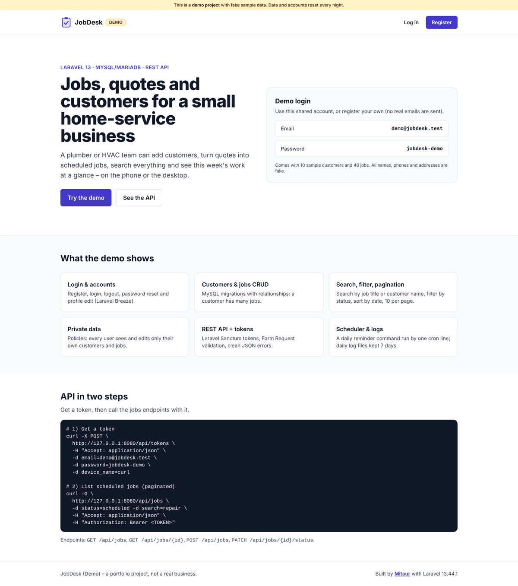

## Contents

- [Features](#features)
- [Screenshots](#screenshots)
- [Tech stack](#tech-stack)
- [Local setup](#local-setup)
- [Tests](#tests)
- [REST API](#rest-api)
- [Scheduler, cron & logs](#scheduler-cron--logs)
- [Deploying to shared hosting (e.g. Hostinger)](#deploying-to-shared-hosting-eg-hostinger)
- [Project notes](#project-notes)

## Features

| Area | What it does |
|---|---|
| **Auth** | Register, login, logout, password reset (log mailer – no real emails), profile edit – Laravel Breeze (Blade + Tailwind) |
| **Customers** | CRUD; a customer *has many* jobs; search by name, phone or email |
| **Jobs** | CRUD; status `quote / scheduled / done / cancelled`, price, scheduled date, notes |
| **Jobs list** | Search (job title **and** customer name), status filter, sort by date, 10 per page – search kept in the page links |
| **Dashboard** | Count per status, number of customers, this week's jobs |
| **Private data** | Policies: every user sees and edits **only their own** customers and jobs – other users get **404** |
| **REST API** | Sanctum Bearer tokens (read / write abilities, 7-day expiry), Form Request validation, API Resources, clean JSON errors |
| **Scheduler** | `jobs:remind-tomorrow` runs daily from **one cron line** and writes a log line per job |
| **Logs** | `daily` channel, 7 days kept (`LOG_DAILY_DAYS=7`), level from `.env` |
| **Demo safety** | Shared demo account can't change its email/password or delete itself; `demo:reset` restores the sample data nightly |
| **UI** | Mobile-first: tables become cards on phones; custom 404 page; Lighthouse 100 / 100 / 100 / 100 (landing + login, mobile + desktop, local) |
| **Tests** | 69 Pest feature tests – run on PHP 8.3 and 8.5 with MariaDB in GitHub Actions |

## Screenshots

| Dashboard | Jobs: search + status filter |
|---|---|
| 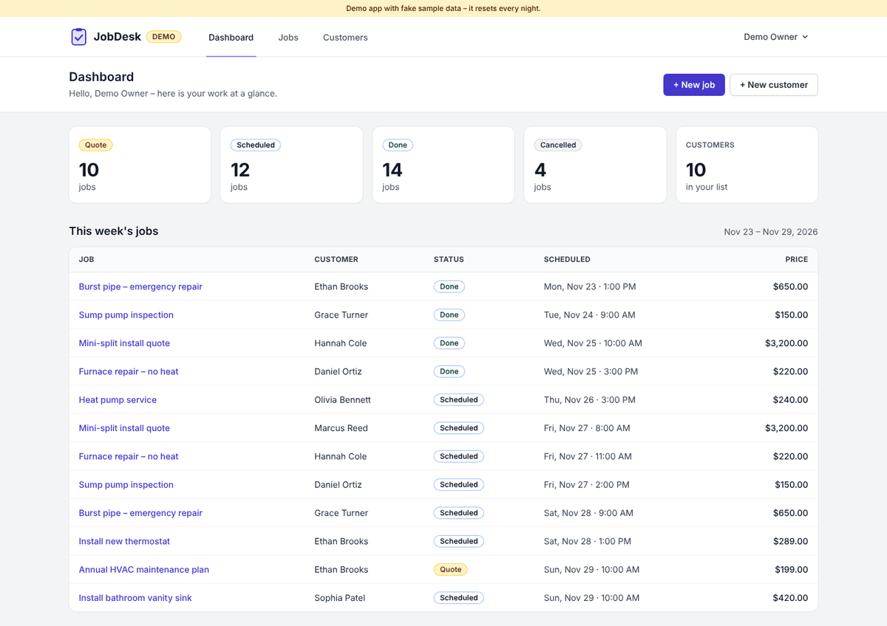 | 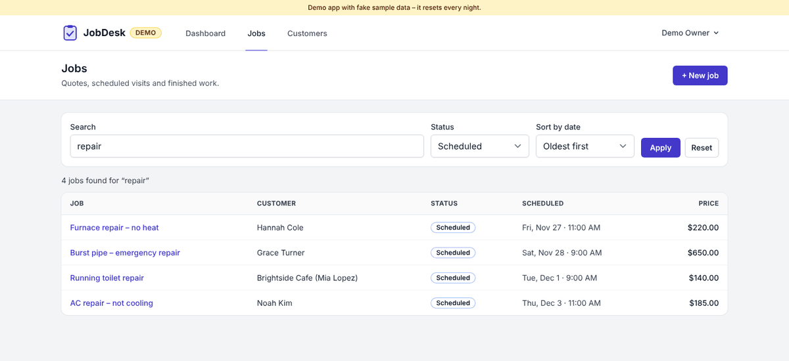 |
| **Page 2 – search kept in the link** | **Validation errors** |
| 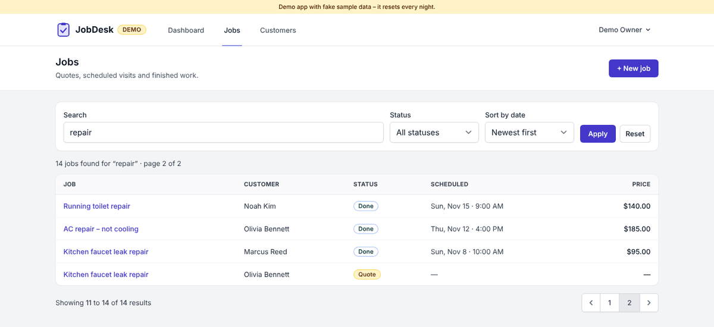 | 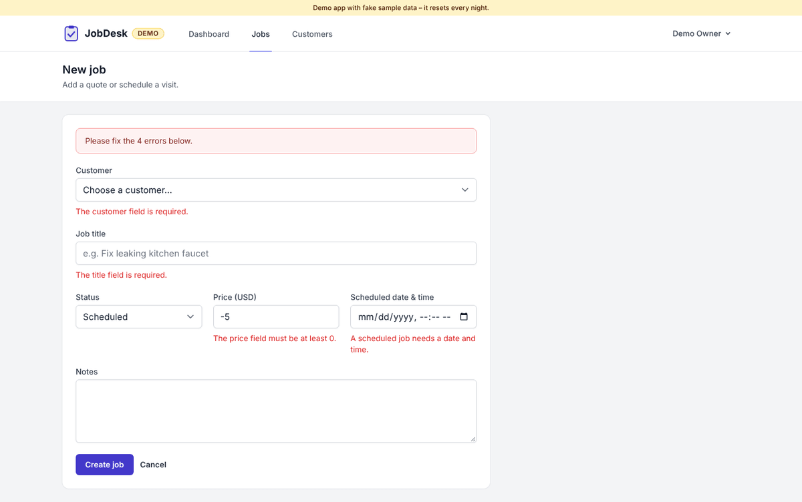 |
| **Customer with their jobs** | **Custom 404** |
| 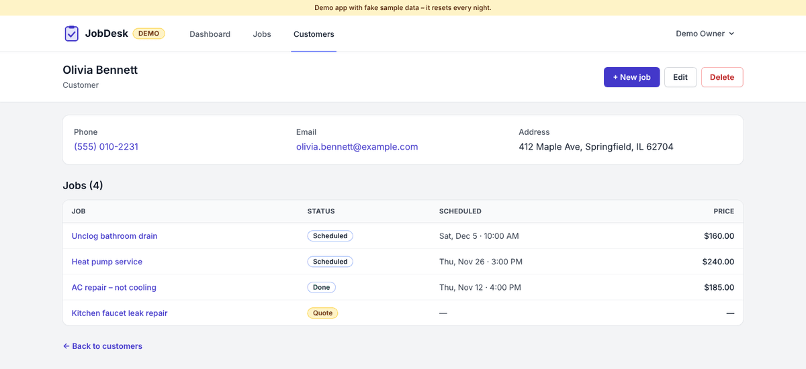 | 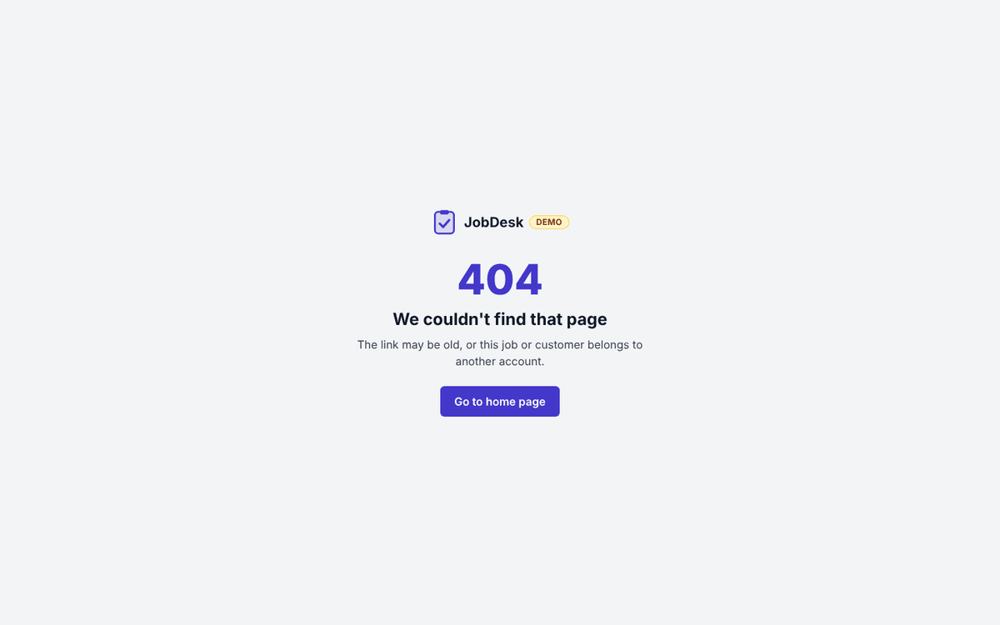 |

**On a phone (390 px)** – tables turn into cards:

| Landing | Dashboard | Jobs, page 2 | Form errors |
|---|---|---|---|
| 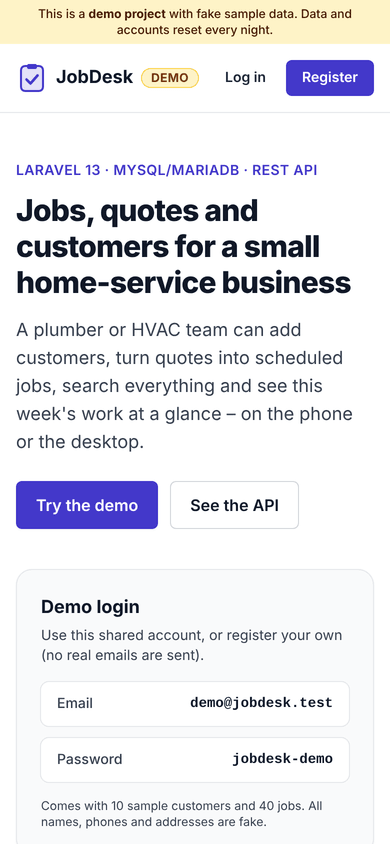 | 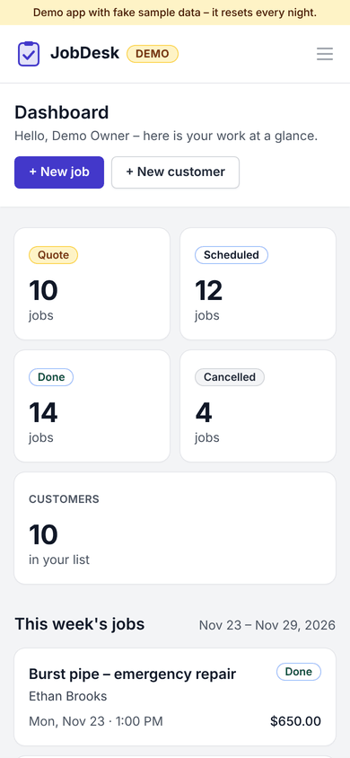 | 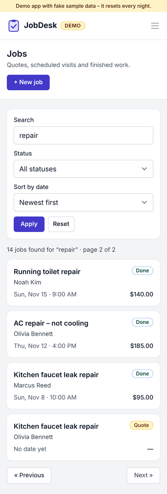 | 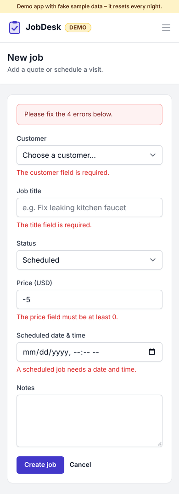 |

**API response** (`GET /api/jobs` with a token, pretty-printed):

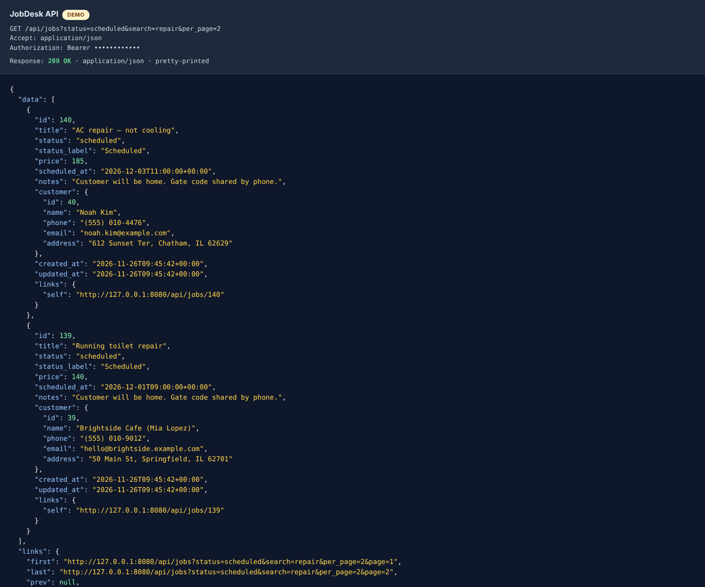

## Tech stack

- **Laravel 13** (PHP 8.3 – 8.5) · **MariaDB / MySQL**
- **Laravel Breeze** – Blade, Tailwind CSS 3, Alpine.js (only inside the app; public pages ship no JavaScript)
- **Laravel Sanctum 4** – API tokens
- **Pest 4** – feature tests · **Laravel Pint** – code style · **GitHub Actions** – CI
- **Vite** – asset build

> The "Jobs" model is called `ServiceJob` (table `service_jobs`) because Laravel already uses a table named `jobs`
> for its queue. URLs are still `/jobs` and `/api/jobs`.

## Local setup

Requirements: PHP 8.3+, Composer, Node 20+, MariaDB 10.6+ or MySQL 8.

```bash
git clone https://github.com/Mitaur/jobdesk-laravel-demo.git
cd jobdesk-laravel-demo

composer install
cp .env.example .env            # then set DB_DATABASE, DB_USERNAME, DB_PASSWORD
php artisan key:generate

php artisan migrate --seed      # demo user + 10 customers + 40 jobs
npm install && npm run build

php artisan serve               # http://127.0.0.1:8000
```

Log in with `demo@jobdesk.test` / `jobdesk-demo`, or register your own account.
Password-reset emails are written to `storage/logs/` (mailer `log`), nothing is sent.

## Tests

```bash
php artisan test                # SQLite in memory (default phpunit.xml) – no setup needed

# same database type as production:
DB_CONNECTION=mariadb DB_DATABASE=jobdesk_test DB_USERNAME=... DB_PASSWORD=... php artisan test

vendor/bin/pint --test          # code style
```

69 feature tests cover: auth (Breeze), customer + job CRUD, validation, **another user is blocked (404)**,
search / filter / sort / pagination, dashboard counts, the whole API (token required, read-only token can't write,
validation errors, status update), the scheduler command and the demo-account protection.
GitHub Actions runs them on **PHP 8.3 and 8.5 with MariaDB 11** on every push.

## REST API

All responses are JSON. Send `Accept: application/json`.

**1. Get a token** (6 attempts per minute):

```bash
curl -X POST \
  http://127.0.0.1:8000/api/tokens \
  -H "Accept: application/json" \
  -d email=demo@jobdesk.test \
  -d password=jobdesk-demo \
  -d device_name=curl
# → 201 {"token":"1|AbC...","token_type":"Bearer","expires_at":"..."}
```

**2. Use it** (60 requests per minute):

```bash
TOKEN="1|AbC..."

# list (paginated, 10 per page): ?search= ?status= ?sort=asc|desc ?per_page=1-50
curl -G http://127.0.0.1:8000/api/jobs \
  -d status=scheduled -d search=repair \
  -H "Accept: application/json" -H "Authorization: Bearer $TOKEN"

# one job
curl http://127.0.0.1:8000/api/jobs/12 \
  -H "Accept: application/json" -H "Authorization: Bearer $TOKEN"

# create
curl -X POST http://127.0.0.1:8000/api/jobs \
  -H "Accept: application/json" -H "Authorization: Bearer $TOKEN" \
  -d customer_id=1 -d title="Replace water heater" -d status=scheduled \
  -d price=1450 -d scheduled_at="2026-12-02 09:00"

# change status
curl -X PATCH http://127.0.0.1:8000/api/jobs/12/status \
  -H "Accept: application/json" -H "Authorization: Bearer $TOKEN" \
  -d status=done

# revoke the token
curl -X DELETE http://127.0.0.1:8000/api/tokens/current \
  -H "Accept: application/json" -H "Authorization: Bearer $TOKEN"
```

| Method | URL | Notes |
|---|---|---|
| POST | `/api/tokens` | `email`, `password`, `device_name` → token with `jobs:read` + `jobs:write` |
| DELETE | `/api/tokens/current` | revoke the token used for the request → 204 |
| GET | `/api/jobs` | your jobs only; `links` + `meta` for pagination |
| GET | `/api/jobs/{id}` | your job, else 404 |
| POST | `/api/jobs` | `customer_id` (must be **your** customer), `title`, `status`, `price`, `scheduled_at`, `notes` → 201 + `Location` header |
| PATCH | `/api/jobs/{id}/status` | `status`; a job can only become `scheduled` if it has a date |

**Errors** – always JSON, never a stack trace:

```json
401 {"message": "Unauthenticated."}
403 {"message": "This action is not allowed."}
404 {"message": "Resource not found."}
422 {"message": "The title field is required.", "errors": {"title": ["The title field is required."]}}
429 {"message": "Too many requests. Please slow down."}
```

## Scheduler, cron & logs

Scheduled tasks live in `routes/console.php`:

| Command | When | What |
|---|---|---|
| `jobs:remind-tomorrow` | daily 07:00 | one log line per job scheduled for tomorrow (a real app would send SMS/email) |
| `demo:reset` | daily 03:00, only if `DEMO_MODE=true` | deletes all accounts and data, re-seeds the demo |
| `sanctum:prune-expired --hours=24` | daily 00:00 | removes expired API tokens |

The server needs **one cron line** (every minute):

```cron
* * * * * cd /path/to/jobdesk && php artisan schedule:run >> /dev/null 2>&1
```

```bash
php artisan schedule:list                     # what will run and when
php artisan jobs:remind-tomorrow              # run now (or --date=2026-12-01)
tail -n 50 storage/logs/laravel-$(date +%F).log
```

Logs: `LOG_CHANNEL=daily` writes `storage/logs/laravel-YYYY-MM-DD.log`, keeps `LOG_DAILY_DAYS=7` days,
and `LOG_LEVEL` (`debug` locally, `info` or `warning` in production) controls how much is written.

## Deploying to shared hosting (e.g. Hostinger)

Needs: PHP 8.3+ (8.5 works), MySQL/MariaDB, SSH, Composer, cron.

**First deploy**

1. Create a MySQL database + user in the hosting panel.
2. Upload the code **outside** the public web folder (or clone it there with Git) – never upload a `.zip` into `public_html`.
3. Point the domain's **document root to the `public/` folder**. Then `.env`, `storage/`, `vendor/` and the logs
   can't be opened from the web.
4. Over SSH, in the project folder:

   ```bash
   composer install --no-dev --optimize-autoloader
   cp .env.example .env      # edit on the server only: APP_ENV=production, APP_DEBUG=false,
                             # APP_URL=https://your-domain, DB_* (DB_HOST=127.0.0.1), LOG_LEVEL=info
   php artisan key:generate
   php artisan migrate --seed --force
   php artisan optimize      # config, route, view and event cache
   ```

5. Build the CSS/JS (`npm ci && npm run build`) locally or in CI and upload `public/build/` if the server has no Node.
6. Add the cron line above (hPanel → Advanced → Cron Jobs, or `crontab -e`).
7. Turn on HTTPS (free SSL) and force `http → https`.
8. Check: `https://your-domain/.env` and `/storage/logs/` must **not** open; `APP_DEBUG=false`.

**Updating**

```bash
php artisan down
git pull                                  # or upload the changed files
composer install --no-dev --optimize-autoloader
php artisan migrate --force
php artisan optimize:clear && php artisan optimize
php artisan up
```

**Staging:** use a second subdomain with its own database and `.env` (`APP_ENV=staging`), deploy there first,
then repeat the same steps on production.

`public/.htaccess` already adds: 1-year caching for hashed CSS/JS, gzip, basic security headers
(`X-Content-Type-Options`, `X-Frame-Options`, `Referrer-Policy`, `Permissions-Policy`) and hides `X-Powered-By`.

## Project notes

- **Ownership through the customer:** a job has no `user_id`; the owner is `job → customer → user`
  (`User::serviceJobs()` is a `hasManyThrough`). One source of truth.
- **404 instead of 403** for other users' records (`Response::denyAsNotFound()`), checked **before** validation,
  so nobody can find out that a record id exists.
- **Seeder without Faker:** production installs with `--no-dev`, where Faker is missing. The demo seeder uses fixed
  sample data; factories (Faker) are used by tests only.
- `.env` is never committed. `.env.example` has empty `APP_KEY` and `DB_PASSWORD`.
  The demo password `jobdesk-demo` is public on purpose (it's shown on the landing page).

---

Built by **[Mitaur](https://mitaur.com)** – WordPress & web developer. Demo project, fake data.
